# fastcompress

[English](README.md) | 한국어



fastcompress는 gzip, DEFLATE, zstd 데이터를 cgo 없이 Go로 압축하고 해제합니다. Apple M1 Pro에서 100 MB 로그를 `klauspost/compress/gzip`보다 약 3.3배 빠르게 해제하며, 이 속도는 macOS 시스템 zlib과 같은 수준입니다. Intel Xeon에서 측정한 모든 파일에서 zstd 해제와 압축이 `klauspost/compress/zstd`보다 빨랐습니다.

`compress/gzip`, `klauspost/compress`와 코드가 어떻게 다른지는 [fastcompress가 빠른 이유](#fastcompress가-빠른-이유)에 정리했습니다.

| 패키지 | 형식 |
|---|---|
| `github.com/x-mesh/fastcompress/gzip` | gzip, raw DEFLATE |
| `github.com/x-mesh/fastcompress/zstd` | zstd |

## 설치

```sh
go get github.com/x-mesh/fastcompress
```

Go 1.24 이상이 필요하며, 의존성은 없습니다.

### fastgzip에서 옮기기

v0.1.2까지 이 모듈은 `github.com/x-mesh/fastgzip`였고, 모든 함수가 한 패키지에 있었습니다. import를 다음과 같이 바꿔 주세요.

| fastgzip | fastcompress |
|---|---|
| `fastgzip.Gunzip`, `fastgzip.NewReader`, `fastgzip.Gzip` 등 gzip과 DEFLATE 이름 | `gzip` 패키지의 같은 이름 |
| `fastgzip.Unzstd` | `zstd.Decode` |
| `fastgzip.NewZstdReader`, `fastgzip.ZstdReader` | `zstd.NewReader`, `zstd.Reader` |
| `fastgzip.Zstd` | `zstd.Encode` |
| `fastgzip.NewZstdWriter`, `fastgzip.ZstdWriter` | `zstd.NewWriter`, `zstd.Writer` |

zstd 패키지에는 별도의 `ErrHeader`, `ErrChecksum`, `ErrCorrupt`가 있습니다. 오류 문구는 `gzip:` 또는 `zstd:`로 시작합니다.

## 사용

패키지 이름은 `gzip`과 `zstd`입니다. 같은 파일에서 `compress/gzip`도 import한다면 둘 중 하나에 다른 이름을 붙여 주세요.

```go
import (
	stdgzip "compress/gzip"

	"github.com/x-mesh/fastcompress/gzip"
)
```

읽기에서는 `Reader`가 `compress/gzip.Reader`를 대신합니다.

```go
z, err := gzip.NewReader(file)
if err != nil {
	return err
}
defer z.Close()
_, err = io.Copy(dst, z)
```

다 쓴 reader는 `Close`를 호출해 주세요. `Close`는 1.3 MB 버퍼를 풀에 돌려주고, 다음 `NewReader`가 이 버퍼를 다시 씁니다. `Reset`은 같은 reader로 새 스트림을 시작합니다.

데이터가 이미 메모리에 있으면 `Gunzip`을 쓰세요.

```go
text, err := gzip.Gunzip(compressed)
```

`Inflate(dst, src)`는 raw DEFLATE 스트림 하나를 해제합니다. 결과를 `dst` 뒤에 붙이고, 사용한 입력 바이트 수를 반환합니다.

오류는 `ErrHeader`, `ErrChecksum`, `ErrCorrupt`입니다. 입력이 잘려 있으면 `io.ErrUnexpectedEOF`를 반환합니다. `Reader`는 이 오류를 반환하기 전에 해제한 바이트를 모두 돌려줍니다.

## 압축

`Writer`가 `compress/gzip.Writer`를 대신합니다.

```go
z, err := gzip.NewWriterLevel(file, gzip.BestSpeed)
if err != nil {
	return err
}
if _, err := io.Copy(z, src); err != nil {
	return err
}
return z.Close()
```

`Close`는 gzip trailer를 쓰고 버퍼를 풀에 돌려주지만, `file`은 닫지 않습니다. `Flush`는 writer가 가진 데이터를 모두 써서 reader가 해제할 수 있게 합니다. `Reset`은 같은 writer로 새 스트림을 시작합니다.

데이터가 이미 메모리에 있으면 `Gzip`을 쓰세요.

```go
compressed, err := gzip.Gzip(text, gzip.DefaultCompression)
```

`Deflate(dst, src, level)`는 raw DEFLATE 스트림 하나로 압축해 `dst` 뒤에 붙입니다.

레벨 값은 `compress/gzip`과 같습니다. `BestSpeed`는 1, `BestCompression`은 9입니다. `DefaultCompression`(-1)은 레벨 6입니다. `NoCompression`(0)은 stored 블록을 쓰고, `HuffmanOnly`(-2)는 리터럴만 씁니다.

`Flush`를 호출하지 않으면, 입력과 레벨이 같을 때 `Writer`는 `Gzip`과 같은 바이트를 씁니다.

### 여러 코어로 압축

`GzipConcurrent`와 `Writer.SetConcurrency`는 여러 goroutine에서 압축합니다.

```go
compressed, err := gzip.GzipConcurrent(text, gzip.DefaultCompression, 0)
```

```go
z := gzip.NewWriter(file)
z.SetConcurrency(runtime.GOMAXPROCS(0)) // before the first Write
```

입력은 약 1 MB 단위 청크로 나뉩니다. 각 청크는 바로 앞의 32 KB를 사전으로 쓰므로, 출력 크기는 `Gzip`의 출력과 거의 같습니다. 출력은 goroutine 수와 상관없이 같습니다. 입력이 1 MB 이하면 `Gzip`의 출력과 같습니다. `Flush`를 호출하지 않으면 병렬 `Writer`는 `GzipConcurrent`와 같은 바이트를 씁니다.

병렬 `Writer`는 goroutine마다 입력과 출력 청크를 최대 두 개씩 가지고 있습니다. `GzipConcurrent`에 개수로 0을 주면 `runtime.GOMAXPROCS(0)`개의 goroutine을 씁니다.

## zstd

메모리에 있는 zstd 데이터는 `zstd.Decode`로 해제합니다.

```go
text, err := zstd.Decode(compressed)
```

`zstd.Reader`는 zstd 스트림을 읽습니다. `NewReader`, `Read`, `Reset`, `Close`는 `gzip.Reader`의 메서드처럼 동작합니다.

```go
z, err := zstd.NewReader(file)
if err != nil {
	return err
}
defer z.Close()
_, err = io.Copy(dst, z)
```

`zstd.Encode`는 zstd 프레임 하나를 `dst` 뒤에 붙입니다. 레벨 1이 가장 빠르고, 레벨 3은 `zstd -3`처럼 압축률이 더 좋습니다. 3보다 낮은 레벨은 레벨 1의 방식을, 3보다 높은 레벨은 레벨 3의 방식을 씁니다.

```go
compressed := zstd.Encode(nil, data, 1)
```

`zstd.Writer`는 스트림을 프레임 하나로 압축합니다. 프레임을 끝내려면 `Close`를 호출해 주세요.

```go
w := zstd.NewWriter(file, 1)
if _, err := io.Copy(w, src); err != nil {
	return err
}
return w.Close()
```

해제기는 skippable 프레임을 건너뛰고, 사전(dictionary)은 지원하지 않습니다. `zstd.Reader`는 zstd 라이브러리의 기본값처럼 128 MB보다 큰 윈도를 거부합니다. magic number가 잘못되면 `zstd.ErrHeader`, 콘텐츠 체크섬이 틀리면 `zstd.ErrChecksum`, 그 밖의 잘못된 데이터는 `zstd.ErrCorrupt`를 반환합니다.

CPU가 둘 이상이면 zstd 코드는 1 MB 이상의 데이터에 두 번째 goroutine을 씁니다. `zstd.Reader`와, arm64에서의 `zstd.Decode`는 세 번째 goroutine을 씁니다. `zstd.Writer`는 항상 두 번째 goroutine을 씁니다. 그래서 호출 한 번은 빨라지지만 CPU 시간은 더 듭니다. goroutine 하나만 쓰려면 `GOMAXPROCS=1`로 설정하세요. `zstd.Writer` 아래 writer에서 난 쓰기 오류는 다음 `Flush`나 `Close`에서 드러납니다.

## compress/gzip과 다른 API

아래 내용은 `gzip` 패키지에 해당합니다.

- `Reader`는 헤더 필드(`Name`, `Comment`, `ModTime`)를 제공하지 않습니다.
- `Reader`는 이어 붙인 멤버를 항상 스트림 하나로 읽으며, `Multistream` 설정이 없습니다.
- `Writer`는 헤더 필드(`Name`, `Comment`, `ModTime`)를 쓰지 않습니다. OS 필드는 `compress/gzip`처럼 255(unknown)입니다.
- 압축된 바이트는 `compress/gzip`의 출력과 다릅니다.

## 성능

### gzip 해제

표는 11회 실행한 시간의 중앙값을 밀리초로 보여 줍니다. 측정 환경은 Apple M1 Pro, macOS 27, Go 1.27.3입니다. 각 해제기는 1 MB `bufio.Reader`를 거쳐 64 KB씩 읽습니다. 파일은 100 MB 합성 애플리케이션 로그, Go 바이너리를 묶은 45 MB tar, Go 소스를 묶은 61 MB tar이며, gzip 레벨 1과 6으로 압축했습니다. zstd 섹션도 같은 파일을 씁니다.

| 파일 | 크기 | compress/gzip | klauspost v1.20.3 | fastcompress |
|---|---|---|---|---|
| 로그, 레벨 1 | 100 MB | 310 | 223 | 67.5 |
| 로그, 레벨 6 | 100 MB | 265 | 193 | 70.2 |
| 바이너리, 레벨 1 | 45 MB | 252 | 178 | 62.7 |
| 바이너리, 레벨 6 | 45 MB | 218 | 152 | 56.7 |
| 소스, 레벨 1 | 61 MB | 222 | 156 | 51.1 |
| 소스, 레벨 6 | 61 MB | 187 | 132 | 46.0 |

비교하면 Apple libz 1.2.12는 C `inflate` 호출 한 번으로 레벨 1 로그를 66.1 ms에 해제하고, `Gunzip`은 62.7 ms에 해제합니다. 같은 Mac의 Docker에서 돌린 Linux arm64에서는 이 파일의 `Reader` 시간이 66.7 ms입니다. 같은 환경에서 klauspost는 222 ms, Python으로 호출한 Debian zlib 1.3.1은 178 ms가 걸립니다.

다음 표는 amd64 결과입니다. 측정 환경은 Intel Xeon Silver 4112(4코어, 8스레드), Linux, Go 1.27.1입니다. 표는 11회 실행한 시간의 중앙값을 밀리초로 보여 주며, `Reader` 설정은 위와 같습니다. 파일도 위 표와 같습니다. "Go 루프" 열은 어셈블리를 끄는 `-tags purego`로 빌드한 fastcompress입니다.

| 파일 | 크기 | compress/gzip | klauspost v1.20.3 | fastcompress, Go 루프 | fastcompress |
|---|---|---|---|---|---|
| 로그, 레벨 1 | 100 MB | 532 | 389 | 161.0 | 106.5 |
| 로그, 레벨 6 | 100 MB | 480 | 335 | 148.0 | 115.3 |
| 바이너리, 레벨 1 | 45 MB | 421 | 311 | 133.8 | 98.8 |
| 바이너리, 레벨 6 | 45 MB | 361 | 270 | 114.9 | 86.9 |
| 소스, 레벨 1 | 61 MB | 371 | 274 | 116.8 | 78.6 |
| 소스, 레벨 6 | 61 MB | 304 | 227 | 99.4 | 72.8 |

비교하면 libdeflate 1.19는 C 호출 한 번으로 레벨 1 로그를 96.0 ms에 해제합니다. `Gunzip`은 107.5 ms, 어셈블리 없이는 156.8 ms가 걸립니다.

가지고 있는 파일로 측정하려면 벤치마크 도구를 실행하세요. 이 도구는 모든 해제기의 출력이 같은지도 확인합니다.

```sh
cd bench
go run . -stream -n 9 /path/to/*.gz
```

### gzip 압축

큰 파일에서 모든 레벨로 fastcompress와 `klauspost/compress/gzip`을 비교했습니다. 레벨 1-3에서 fastcompress는 시간이 3-19% 덜 걸립니다. 레벨 4-9에서는 29% 덜 걸리는 경우부터 10% 더 걸리는 경우까지 있습니다. 시간이 더 걸린 경우는 레벨 4와 6의 바이너리, 레벨 6과 7의 로그뿐입니다. 출력 크기는 거의 같습니다. goroutine 8개에서 `GzipConcurrent`는 `Gzip`보다 시간이 3.9-5.6배 덜 걸리고, 출력 크기 차이는 0.001% 이내입니다. 표는 레벨 1, 6, 9를 보여 줍니다.

표는 5회 실행한 시간의 중앙값(밀리초)과 입력 대비 출력 크기(%)를 보여 줍니다. 측정 환경은 Intel Xeon Silver 4112(4코어, 8스레드), Linux, Go 1.27.1입니다. 각 압축기는 모든 데이터를 메모리에서 받습니다. 마지막 열은 goroutine 8개에서 실행한 `GzipConcurrent`이고, 나머지 압축기는 goroutine 하나를 씁니다. `klauspost/pgzip`과는 비교하지 않았습니다. fastcompress 열은 `Gzip`입니다. 이 벤치마크에서 모든 데이터를 `Write` 한 번으로 받은 `Writer`는 `Gzip`보다 시간이 최대 12% 더 걸립니다.

| 파일 | 레벨 | compress/gzip | klauspost v1.20.3 | fastcompress | fastcompress, goroutine 8개 |
|---|---|---|---|---|---|
| Go 소스 파일, 50 MB | 1 | 284 (21.46%) | 238 (21.46%) | 209 (21.19%) | 51 (21.19%) |
| Go 바이너리, 30 MB | 1 | 298 (44.99%) | 239 (44.99%) | 210 (44.09%) | 54 (44.09%) |
| 생성한 접근 로그, 100 MB | 1 | 589 (22.83%) | 492 (22.83%) | 418 (22.61%) | 93 (22.61%) |
| Go 소스 파일, 50 MB | 6 | 556 (17.67%) | 435 (17.67%) | 409 (17.66%) | 103 (17.66%) |
| Go 바이너리, 30 MB | 6 | 564 (39.91%) | 457 (39.91%) | 478 (39.65%) | 120 (39.65%) |
| 생성한 접근 로그, 100 MB | 6 | 1172 (20.08%) | 955 (20.08%) | 987 (20.24%) | 244 (20.24%) |
| Go 소스 파일, 50 MB | 9 | 2921 (16.92%) | 2880 (16.92%) | 2492 (16.88%) | 538 (16.88%) |
| Go 바이너리, 30 MB | 9 | 3870 (38.76%) | 3235 (38.76%) | 2366 (38.71%) | 468 (38.71%) |
| 생성한 접근 로그, 100 MB | 9 | 6676 (17.90%) | 6367 (17.90%) | 6130 (18.08%) | 1098 (18.08%) |

Go 1.27에서 `compress/gzip`의 출력 크기는 klauspost와 같습니다.

작은 입력에서는 `Gzip` 호출 한 번의 시간과, 입력마다 reset한 klauspost `Writer` 하나의 시간을 마이크로초로 보여 줍니다. 입력은 로그의 일부이며, 값은 5회 실행의 중앙값 중 가장 낮은 값입니다.

| 입력 | 레벨 | klauspost v1.20.3 | fastcompress |
|---|---|---|---|
| 1 KB | 1 | 10.3 | 9.7 |
| 8 KB | 1 | 33.0 | 32.6 |
| 64 KB | 1 | 286 | 298 |
| 1 KB | 6 | 12.9 | 13.9 |
| 8 KB | 6 | 63.3 | 77.9 |
| 64 KB | 6 | 578 | 700 |

레벨 6에서 fastcompress의 해시 테이블은 768 KB이고, 작은 입력은 이 테이블을 효율적으로 쓰지 못합니다.

arm64에서는 macOS 27, Go 1.27.3을 쓰는 Apple M1 Pro에서 gzip 해제 표와 같은 파일로 측정했습니다. 각 값은 5회 실행의 중앙값입니다. 레벨 1, 6, 9에서 fastcompress는 klauspost보다 시간이 8-32% 덜 걸립니다. goroutine 10개에서 `GzipConcurrent`는 `Gzip`보다 시간이 6.2-7.4배 덜 걸립니다. 모든 데이터를 `Write` 한 번으로 받은 `Writer`는 `Gzip`보다 시간이 최대 4% 더 걸립니다.

| 파일 | 레벨 | compress/gzip | klauspost v1.20.3 | fastcompress | fastcompress, goroutine 10개 |
|---|---|---|---|---|---|
| 로그 | 1 | 271 (18.17%) | 234 (18.17%) | 158 (17.83%) | 24 (17.83%) |
| 바이너리 | 1 | 234 (40.92%) | 197 (40.92%) | 149 (40.03%) | 22 (40.03%) |
| 소스 | 1 | 214 (27.68%) | 184 (27.68%) | 141 (26.32%) | 23 (26.31%) |
| 로그 | 6 | 545 (15.95%) | 456 (15.95%) | 396 (16.23%) | 56 (16.22%) |
| 바이너리 | 6 | 446 (36.40%) | 380 (36.40%) | 351 (36.17%) | 51 (36.18%) |
| 소스 | 6 | 412 (23.10%) | 346 (23.10%) | 299 (23.06%) | 43 (23.06%) |
| 로그 | 9 | 2391 (14.66%) | 2117 (14.66%) | 1837 (14.83%) | 250 (14.83%) |
| 바이너리 | 9 | 3862 (35.52%) | 3013 (35.52%) | 2171 (35.38%) | 320 (35.38%) |
| 소스 | 9 | 3219 (22.38%) | 2718 (22.38%) | 2316 (22.28%) | 374 (22.28%) |

압축을 측정하려면 압축하지 않은 파일과 레벨을 벤치마크 도구에 주세요. 도구는 각 출력을 `compress/gzip`으로 해제해 입력과 비교합니다.

```sh
cd bench
go run . -compress 6 -n 5 /path/to/files/*
```

### zstd

표는 시간의 중앙값을 밀리초로 보여 줍니다. 측정 환경은 Intel Xeon Silver 4112(4코어, 8스레드), Linux, Go 1.27.1입니다. 비교한 라이브러리는 `klauspost/compress` v1.20.3입니다. 다른 사용자도 이 머신을 쓰고 있었으므로 시간은 5% 정도 달라질 수 있습니다.

파일은 100 MB 합성 애플리케이션 로그, Go 바이너리를 묶은 45 MB tar, Go 소스를 묶은 61 MB tar입니다. zstd 1.5.5 명령으로 레벨 1, 3, 19로 압축했습니다.

해제, 21회 실행. reader는 1 MB `bufio.Reader`를 거쳐 64 KB씩 읽습니다. `DecodeAll`은 설정과 상관없이 goroutine 하나를 쓰므로, 표에는 goroutine 1개와 4개로 실행한 두 결과 중 빠른 쪽을 적었습니다. klauspost `Decoder`는 기본 동시성을 씁니다.

| 파일 | 레벨 | klauspost `DecodeAll` | `zstd.Decode` | klauspost `Decoder` | `zstd.Reader` |
|---|---|---|---|---|---|
| 로그 | 1 | 121.8 | 89.6 | 100.3 | 80.9 |
| 로그 | 3 | 128.2 | 89.8 | 93.6 | 88.0 |
| 로그 | 19 | 109.4 | 63.6 | 78.0 | 72.9 |
| 바이너리 | 1 | 72.2 | 60.5 | 54.6 | 45.9 |
| 바이너리 | 3 | 80.2 | 57.5 | 61.5 | 54.2 |
| 바이너리 | 19 | 99.1 | 88.0 | 99.2 | 83.6 |
| 소스 | 1 | 76.0 | 55.8 | 62.9 | 49.0 |
| 소스 | 3 | 84.5 | 58.0 | 68.7 | 60.2 |
| 소스 | 19 | 92.5 | 83.4 | 93.3 | 80.7 |

`GOMAXPROCS=1`에서 `zstd.Decode`는 이 파일들에 72-126 ms가 걸립니다. `DecodeAll`보다 3% 느린 경우부터 14% 빠른 경우까지 있습니다.

메모리에서 압축, 9회 실행. 괄호 안은 압축률입니다. `klauspost/compress`는 `zstd.EncoderLevelFromZstd`를 써서 레벨 1에 `SpeedFastest`, 레벨 3에 `SpeedDefault`를 씁니다. `EncodeAll`은 goroutine 하나를 씁니다.

| 파일 | 레벨 | klauspost `EncodeAll` | `zstd.Encode` | `zstd.Encode`, CPU 1개 |
|---|---|---|---|---|
| 로그 | 1 | 458.6 (6.110) | 260.9 (6.153) | 373.7 |
| 바이너리 | 1 | 336.6 (2.704) | 192.6 (2.745) | 269.5 |
| 소스 | 1 | 308.7 (4.129) | 182.0 (4.341) | 248.9 |
| 로그 | 3 | 616.8 (5.952) | 442.1 (6.075) | 555.0 |
| 바이너리 | 3 | 419.5 (2.829) | 337.7 (2.827) | 397.8 |
| 소스 | 3 | 386.6 (4.655) | 273.1 (4.717) | 347.9 |

64 KB씩 쓰는 스트림 압축, 7회 실행. 압축률은 위와 같습니다. `klauspost/compress` `Encoder`는 기본 동시성을 씁니다.

| 파일 | 레벨 | klauspost `Encoder` | `zstd.Writer` |
|---|---|---|---|
| 로그 | 1 | 404.8 | 275.8 |
| 바이너리 | 1 | 254.2 | 187.4 |
| 소스 | 1 | 314.8 | 182.3 |
| 로그 | 3 | 547.2 | 473.7 |
| 바이너리 | 3 | 339.7 | 315.3 |
| 소스 | 3 | 358.8 | 306.9 |

다음 표는 arm64 결과입니다. 측정 환경은 Apple M1 Pro, macOS 27, Go 1.27.3이고, 파일과 설정은 위와 같습니다. 이 머신에서 다른 프로그램도 실행 중이었으므로 시간은 5% 정도 달라질 수 있습니다.

해제, 21회 실행:

| 파일 | 레벨 | klauspost `DecodeAll` | `zstd.Decode` | klauspost `Decoder` | `zstd.Reader` |
|---|---|---|---|---|---|
| 로그 | 1 | 60.4 | 35.9 | 35.2 | 34.8 |
| 로그 | 3 | 58.3 | 39.7 | 36.2 | 38.7 |
| 로그 | 19 | 46.6 | 23.7 | 30.0 | 27.7 |
| 바이너리 | 1 | 39.1 | 22.1 | 21.6 | 22.3 |
| 바이너리 | 3 | 40.2 | 25.9 | 25.0 | 25.6 |
| 바이너리 | 19 | 47.2 | 33.6 | 36.3 | 33.7 |
| 소스 | 1 | 40.2 | 24.4 | 24.3 | 24.3 |
| 소스 | 3 | 40.9 | 28.7 | 27.4 | 28.4 |
| 소스 | 19 | 44.2 | 34.1 | 36.0 | 34.1 |

`GOMAXPROCS=1`에서 `zstd.Decode`는 이 파일들에 40-62 ms가 걸리며, `DecodeAll`보다 0-13% 느립니다. `zstd.Reader`는 41-64 ms가 걸리며, klauspost `Decoder`보다 1-5% 느립니다. klauspost/compress도 시퀀스를 arm64 어셈블리로 해석합니다.

메모리에서 압축, 9회 실행. 괄호 안은 압축률입니다. "CPU 1개" 열은 15회 실행했습니다.

| 파일 | 레벨 | klauspost `EncodeAll` | `zstd.Encode` | `zstd.Encode`, CPU 1개 |
|---|---|---|---|---|
| 로그 | 1 | 199.3 (6.110) | 121.9 (6.153) | 197.4 |
| 바이너리 | 1 | 132.9 (2.704) | 77.0 (2.745) | 130.8 |
| 소스 | 1 | 136.8 (4.129) | 87.3 (4.341) | 139.6 |
| 로그 | 3 | 241.5 (5.952) | 172.5 (6.075) | 247.1 |
| 바이너리 | 3 | 157.1 (2.829) | 110.4 (2.827) | 164.2 |
| 소스 | 3 | 160.3 (4.655) | 115.1 (4.717) | 165.6 |

CPU 1개에서 `zstd.Encode`는 `EncodeAll`보다 시간이 1.6% 덜 걸리는 경우부터 4.5% 더 걸리는 경우까지 있습니다.

가지고 있는 `.zst` 파일로 측정하려면 벤치마크 도구를 실행하세요. 도구는 zstd 해제기들을 비교하고 출력이 같은지 확인합니다. `-compress`와 `-zstd`를 주면 파일을 그 레벨로 압축하고, 두 해제기가 모두 원본을 복원하는지 확인합니다.

```sh
cd bench
go run . -stream -n 9 /path/to/*.zst
go run . -compress 3 -zstd -n 9 /path/to/files/*
```

## fastcompress가 빠른 이유

### compress/gzip, klauspost/compress와 다른 점

`compress/flate`와 `klauspost/compress/flate` v1.20.3의 DEFLATE 해제기는 설계가 같습니다. fastcompress는 해제 루프에서 시간이 가장 많이 드는 단계를 바꿨습니다.

| 단계 | compress/gzip, klauspost | fastcompress |
|---|---|---|
| 비트 버퍼 | 32비트 | 64비트 |
| 버퍼 채우기 | 루프를 한 번 돌 때마다 1바이트 | 정렬되지 않은 8바이트 로드 한 번, 분기 없음 |
| 첫 테이블 조회 | 리터럴, 길이, 거리 모두 9비트 | 리터럴과 길이 10비트, 거리 7비트 |
| 추가 비트 | 코드를 읽은 뒤 따로 한 번 더 읽음 | 테이블 항목에 포함, 코드와 함께 시프트 한 번으로 제거 |
| 매치 복사 | 32 KB 링 버퍼 안에서 `copy` 호출 | 평평한 버퍼에 16바이트씩 |
| 해제 루프 | Go | amd64에서 BMI2 어셈블리, 그 밖의 플랫폼에서 Go |
| CRC-32 | 같은 goroutine에서 `hash/crc32` | arm64에서 `PMULL` 어셈블리, 1 MB 이상이면 `Gunzip`이 두 번째 goroutine 사용 |

`Reader`의 평평한 버퍼는 마지막 출력 32 KB와 최대 1 MB의 새 출력을 담습니다. 그래서 매치가 버퍼 끝을 넘어 처음으로 되돌아가지 않습니다. `Gunzip`은 결과 슬라이스에 바로 해제합니다.







세 그림은 위 표의 단계를 보여 줍니다. 비트와 바이트 수는 예시입니다.

압축에서 `compress/gzip`과 `klauspost/compress/gzip`은 스트림 하나에 goroutine 하나를 씁니다. `GzipConcurrent`와 `Writer.SetConcurrency`는 입력을 청크로 나눠 여러 goroutine에서 압축하며, 출력 크기는 `Gzip`의 출력과 거의 같습니다.

klauspost의 zstd 코드도 amd64에는 BMI2 어셈블리, arm64에는 시퀀스 어셈블리가 있습니다. 블록의 시퀀스를 모두 해석한 뒤 실행하는 구조도 같습니다. 차이는 [zstd가 빠른 이유](#zstd가-빠른-이유)에 적은 세부 구현과 goroutine 사용에 있습니다. CPU가 둘 이상이면 `zstd.Decode`와 `zstd.Encode`는 1 MB 이상인 프레임 하나를 여러 goroutine으로 처리합니다. klauspost의 `DecodeAll`과 `EncodeAll`은 goroutine 하나를 씁니다.

### 압축 방식

- 레벨 1-3은 체인 없이 해시 테이블 하나로 매치를 찾습니다. 8바이트 로드 한 번으로 두 위치를 확인하고, 리터럴이 이어지면 탐색 간격을 늘립니다.
- 레벨 4-6은 4바이트 해시 테이블과 8바이트 해시 테이블을 씁니다. 두 번째 테이블은 해시마다 위치를 두 개 저장합니다. 레벨 5와 6은 매치가 짧으면 다음 위치도 시도합니다.
- 레벨 7-9는 zlib처럼 해시 체인과 lazy matching을 씁니다. 해시는 17비트이고 체인은 zlib보다 짧습니다. 레벨 9에서 길이 1024 체인은 zlib의 4096 체인과 같은 크기를 냈습니다.
- 블록 하나에는 입력이 최대 65535바이트 들어갑니다. 인코더는 stored, fixed, dynamic 블록의 크기를 각각 계산해 가장 작은 것을 씁니다.
- Huffman 코드 길이는 Moffat-Katajainen 방법으로 구합니다. 길이가 15비트를 넘으면 package-merge 방법을 씁니다.
- 병렬 압축에서는 goroutine마다 16블록 크기의 청크를 맡깁니다. 인코더는 먼저 청크 앞의 32 KB를 해시 테이블에 넣고, 청크 끝에 빈 stored 블록을 붙여 바이트 경계를 맞춥니다. 각 goroutine은 맡은 청크의 CRC-32도 계산하며, zlib `crc32_combine`을 옮긴 코드가 체크섬을 합칩니다.
- 새 스트림을 시작해도 해시 테이블을 지우지 않습니다. 테이블은 위치에 기준값을 더해 저장하고, 인코더는 기준값을 이전 항목 전체보다 뒤로 옮깁니다. 테이블이 최대 768 KB라서, 1 KB 입력에서는 테이블을 지우는 데 시간 대부분이 들었습니다.



### 해제가 빠른 이유

- 64비트 비트 버퍼를 씁니다. 정렬되지 않은 8바이트 로드 한 번으로 분기 없이 채웁니다.
- 테이블 항목마다 코드 길이와 추가 비트를 함께 담습니다. 시프트 한 번으로 코드와 추가 비트를 함께 제거합니다.
- 루트 테이블이 10비트와 7비트라서 두 번째 테이블을 조회해야 하는 코드가 적습니다. 테이블이 들어가지 않으면 9비트와 6비트를 씁니다.
- 해제기는 libdeflate 방식으로 테이블을 만듭니다. 코드마다 한 번만 쓰고, 다음 코드 길이로 넘어갈 때마다 채운 부분을 복사 한 번으로 두 배로 늘립니다. zlib은 테이블 항목을 하나씩 따로 씁니다. Xeon에서 레벨 6 로그의 블록 하나에 대한 리터럴/길이 테이블과 거리 테이블을 만드는 데 3.4 µs 대신 1.2 µs가 걸립니다.
- dynamic 블록 헤더의 코드 길이는 1바이트씩이 아니라 비트 버퍼를 8바이트씩 채워 읽습니다.
- 다음 심볼의 테이블 로드를 버퍼 채우기보다 먼저 시작해 두 지연을 겹칩니다.
- 매치를 복사하기 전에 다음 심볼을 읽습니다.
- 비트 수는 libdeflate 방식으로 셉니다. 해제기는 항목 전체를 빼고 하위 6비트만 씁니다.
- 매치는 16바이트씩 복사합니다. 로그 데이터의 매치는 대부분 16바이트 이하이므로, 처음 32바이트는 루프 조건 없이 복사합니다. 거리가 짧으면 패턴으로 반복합니다.
- BMI2가 있는 amd64에서는 어셈블리 함수가 빠른 루프의 단계를 실행하며, 모든 상태를 레지스터에 둡니다. 컴파일된 Go 루프에서는 시프트 수가 모두 CX를 거쳐야 하고, 일부 값을 단계마다 스택에서 다시 읽습니다. `GOAMD64=v3`만 켰을 때 Go 루프는 8-11% 빨라졌습니다. 런타임은 어셈블리를 선점할 수 없으므로, 호출 한 번은 출력이 약 64 KB가 되면 멈춥니다. 측정한 가장 느린 속도인 출력 바이트당 2.9 ns에서 호출 한 번은 약 0.2 ms가 걸립니다.
- arm64에서는 어셈블리 함수가 `PMULL` carry-less 곱셈으로 CRC-32를 계산합니다. 128비트 레인 8개를 병렬로 접으며, 속도는 45 GB/s로 `hash/crc32`의 8.4 GB/s보다 빠릅니다.
- 1 MB를 넘으면 `Gunzip`은 CRC-32를 두 번째 goroutine에서 계산합니다. 넘길 때마다 goroutine을 깨울 수 있으므로, 해제기는 출력을 1 MB 이상씩 넘깁니다.



### zstd가 빠른 이유

- BMI2가 있는 amd64에서는 어셈블리가 시퀀스와 리터럴의 Huffman 스트림 4개를 해석하고, 시퀀스를 실행하고, 시퀀스를 인코딩합니다. BMI2 시프트는 아무 레지스터에서나 시프트 수를 가져옵니다. `GOAMD64=v3`만 켰을 때 Go 해제기가 15% 빨라졌는데, Go 루프가 시프트 수를 옮기는 데 명령어를 쓰고 있었기 때문입니다.
- arm64에서는 어셈블리가 시퀀스를 해석하고, 실행하고, 인코딩합니다. goroutine 하나에서는 한 루프가 시퀀스마다 해석한 뒤 바로 복사하므로, 해석기가 로드를 기다리는 시간에 복사가 진행됩니다. 단계마다 루프를 따로 두었을 때는 M1 Pro에서 레벨 1의 100 MB 로그에 시간이 18% 더 걸렸습니다.
- 해제기는 블록의 시퀀스를 먼저 배열로 해석한 뒤 실행합니다. 두 루프는 각자 상태를 레지스터에 둡니다.
- 실행 단계는 16바이트씩 복사합니다. 거리가 16바이트보다 가까운 매치는 `PSHUFB` 한 번으로 패턴을 만든 뒤 시작합니다. 루프는 8개 뒤 시퀀스의 매치 원본을 미리 가져옵니다.
- 큰 프레임은 goroutine 두 개로 해제합니다. 하나는 리터럴과 시퀀스를 해석하고, 다른 하나는 시퀀스를 실행합니다. arm64에서는 `zstd.Decode`도 `zstd.Reader`처럼 goroutine 세 개를 씁니다. 하나는 리터럴, 하나는 시퀀스를 해석하고, 나머지 하나가 실행합니다. M1 Pro에서 이 방식으로 `zstd.Decode`가 8-37% 빨라졌습니다. 하이퍼스레딩을 켠 Xeon에서는 레벨 3 로그가 13% 느려졌습니다. 코어마다 스레드 하나만 쓰게 하면 모든 파일이 빨라졌으므로, 느려진 원인은 코어를 공유하는 goroutine일 가능성이 큽니다. Go는 goroutine이 돌 코어를 고르지 않으므로 amd64에서는 goroutine 두 개를 유지합니다.
- 인코더의 해시 테이블 항목은 그 위치의 첫 4바이트를 함께 저장합니다. 매치가 아닌 후보는 입력을 다시 읽지 않고 걸러 냅니다.
- 빠른 레벨은 두 바이트 앞에서 마지막 오프셋을 확인합니다. 두 레벨 모두 최근 오프셋 3개 중 하나와 맞는 매치를 repeat offset으로 인코딩합니다.
- 인코더는 예상 크기를 비교해 기본 FSE 테이블, 이전 테이블, 새 테이블 중 하나를 고릅니다.
- Huffman 인코더는 스트림용으로 확보한 공간에 심볼 4개마다 8바이트를 씁니다. M1 Pro에서 레벨 3 바이너리의 리터럴을 인코딩하는 시간이 32 ms에서 8 ms로 줄었습니다.
- 큰 입력은 goroutine 두 개로 압축합니다. 하나는 매치를 찾고, 다른 하나는 인코딩합니다.



## 안전성

빠른 해제 루프는 `unsafe` 포인터를 쓰거나 amd64에서는 어셈블리를 쓰며, 경계 검사를 하지 않습니다. 다음 조건이 모든 접근을 버퍼 안에 묶어 둡니다.

- 남은 입력이 25바이트보다 적거나 남은 출력 공간이 323바이트보다 적으면 루프가 멈춥니다.
- 테이블 인덱스마다 테이블 크기로 마스크를 씌웁니다.
- 해제기는 매치 거리를 이미 쓴 출력 길이와 비교합니다.

압축기의 매치 탐색도 `unsafe` 포인터로 입력을 읽습니다.

- 8바이트 로드는 블록 끝에서 8바이트 이상 앞선 위치에서만 합니다.
- 매치 후보 위치는 0 이상이고 현재 위치보다 앞일 때만 읽습니다.

토큰 writer는 `unsafe` 포인터로 8바이트씩 씁니다. 블록마다 시작하기 전에, 블록의 심볼 개수로 계산한 비트에 16바이트를 더한 만큼 공간을 확보합니다. 테스트는 각 블록의 토큰에서 심볼 개수를 다시 세고, 개수가 다르면 멈춥니다.

테스트는 랜덤 입력과 fuzz 입력에서 해제기 출력을 `compress/flate`, `compress/gzip`과 비교합니다. 압축기 출력은 `compress/flate`, `compress/gzip`, fastcompress로 해제합니다. 테스트는 `-race`와 `-gcflags=all=-d=checkptr`로 실행합니다. 이 검사는 어셈블리 안을 보지 못합니다. 그래서 별도 테스트와 fuzz 테스트가 어셈블리 루프와 Go 루프가 같은 데이터를 같게 해제하고 같은 데이터를 거부하는지 확인합니다. Linux에서는 해제기의 입력과 출력을 프로세스가 접근할 수 없는 페이지 옆에 두는 테스트가 있어서, 버퍼 끝을 넘는 접근이 일어나면 테스트가 멈춥니다. CI는 `-tags purego`로 Go 루프도 실행합니다. 해제기 테스트는 darwin/arm64, linux/arm64, linux/amd64에서 실행했고, 압축기 테스트는 linux/amd64에서만 실행했습니다.

zstd 해제기도 경계 검사 없이 `unsafe` 포인터와 어셈블리를 씁니다. 다음 조건이 모든 접근을 버퍼 안에 묶어 둡니다.

- 테이블 인덱스마다 테이블 크기로 마스크를 씌웁니다.
- 시퀀스를 복사하기 전에 남은 리터럴, 블록 끝과 비교합니다. 오프셋은 프레임의 출력 길이, 윈도 크기와 비교합니다.
- 출력은 블록마다 뒤에 여유 공간 32바이트를 두고, 리터럴도 끝 뒤에 여유 공간 32바이트를 둡니다.
- 어셈블리 루프는 비트스트림 시작 24바이트 앞에서 멈추고, 나머지는 Go 코드가 해석합니다.

zstd 인코더는 먼저 확보한 공간에만 `unsafe` 포인터로 씁니다. 테이블 인덱스마다 마스크를 씌우고, 위치는 항상 입력 끝보다 8바이트 앞에 둡니다.

zstd 테스트는 zstd 1.5.5 명령으로 만든 파일을 해제해 그 명령의 출력과 비교합니다. `bench` 모듈의 테스트는 fuzz 입력에서 해제기를 `klauspost/compress`와 비교하고, `klauspost/compress`가 거부하는 입력을 fastcompress가 받아들이지 않는지 확인합니다. 인코더 출력은 fastcompress와 `klauspost/compress` 해제기 모두에서 복원되어야 합니다. 인코더 출력을 zstd 명령으로도 해제했습니다. 그 밖의 테스트는 어셈블리와 Go 코드가 같은 출력을 내고 같은 데이터를 거부하는지 확인합니다. 이 테스트의 입력은 파일, 인코더 출력, 손상된 사본, fuzz 입력, 랜덤 시퀀스, 랜덤 테이블로 만든 랜덤 비트스트림입니다. 실행기 테스트는 실행기가 출력 공간 밖에 아무것도 쓰지 않는지도 확인합니다. CI는 `-tags purego`로 Go 코드도 실행합니다.

## 테스트

```sh
go test ./...
go test -run '^$' -fuzz FuzzReader -fuzztime 60s ./gzip
go test -run '^$' -fuzz FuzzWriter -fuzztime 60s ./gzip
```

`.gz` 파일이 있는 디렉터리를 `compress/gzip`과 비교하려면 `FASTCOMPRESS_CORPUS`를 설정하세요.

```sh
FASTCOMPRESS_CORPUS=/path/to/gz-files go test ./gzip
```

파일 하나를 프로파일링하려면 `FASTCOMPRESS_BENCH`를 설정하고 `./gzip`에서 `BenchmarkReader`나 `BenchmarkGunzip`을 실행하세요. 압축하지 않은 파일 하나의 압축을 프로파일링하려면 `FASTCOMPRESS_RAW`를 설정하고 `BenchmarkGzip`을 실행하세요.

zstd:

```sh
go test -run '^$' -fuzz FuzzDecode -fuzztime 60s ./zstd
go test -run '^$' -fuzz FuzzReader -fuzztime 60s ./zstd
go test -run '^$' -fuzz FuzzRoundTrip -fuzztime 60s ./zstd
go test -run '^$' -fuzz FuzzWriter -fuzztime 60s ./zstd
cd bench && go test .
```

`FASTCOMPRESS_ZSTD_CORPUS`는 해제할 `.zst` 파일이 있는 디렉터리입니다. 같은 이름에서 `.zst`를 뺀 파일이 있으면 테스트가 출력을 그 파일과 비교합니다. `FASTCOMPRESS_ZSTD_BENCH`는 `./zstd`의 `BenchmarkDecode`와 `BenchmarkReader`에 쓸 `.zst` 파일 하나입니다. `FASTCOMPRESS_ZSTD_ENC_BENCH`는 `BenchmarkEncode`에 쓸 파일 하나이며, 레벨은 `FASTCOMPRESS_ZSTD_LEVEL`로 정합니다.

## 라이선스

MIT. `gzip/tables.go`의 테이블 빌더는 libdeflate를 따르며, 테스트는 이를 zlib 1.2.12 테이블 빌더를 옮긴 코드와 비교합니다. `gzip/crc32_combine.go`의 CRC-32 결합 코드는 zlib을 옮긴 것입니다. zstd 코드 일부는 Go의 `internal/zstd`와 zstd 라이브러리를 따릅니다. 각 라이선스는 [NOTICE](NOTICE)에 있습니다.
